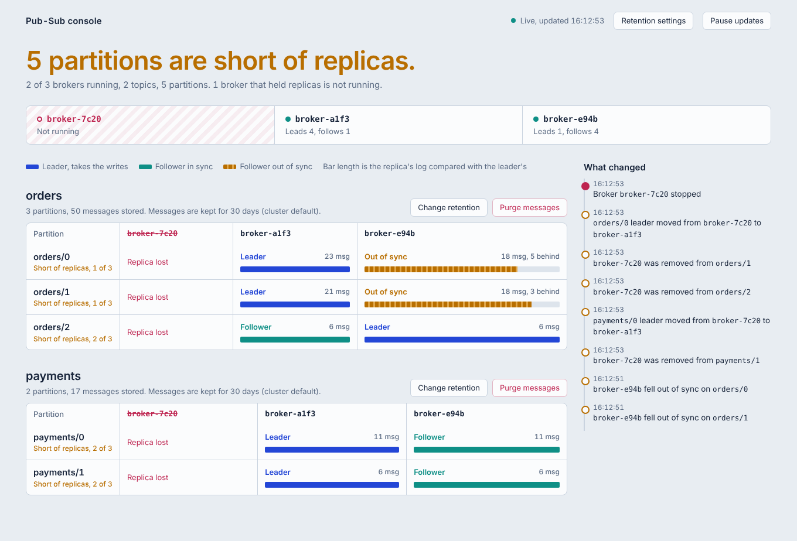
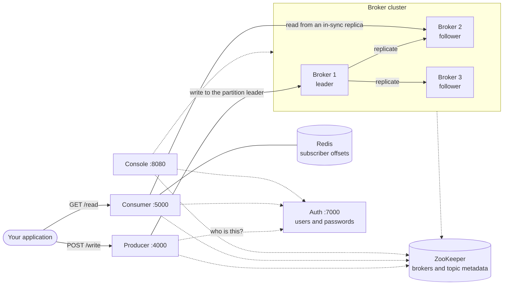

# Distributed Pub-Sub System

A small Kafka-style publish-subscribe system written in Python, built to show how
partitioned, replicated logs work: leaders and followers, in-sync replicas,
leader election and recovery after a crash.

It is a **learning project, not a production message broker**. The whole system
is about 2,000 lines of Python you can read in an afternoon, and it comes with a
live console that shows what the cluster is doing while you break it.



## What it does

- **Topics split into partitions.** A message's key decides its partition, so messages with the same key stay in order.
- **Replication.** Every partition has one leader that takes the writes and followers that hold copies.
- **Automatic failover.** When a leader dies, an in-sync follower takes over. A follower that fell behind is never promoted.
- **Catch-up.** A follower that missed messages is brought up to date by the leader before it counts as in sync again. A restarted broker copies what it missed and rejoins.
- **Per-subscriber offsets.** Each subscriber reads every message once, and continues where it stopped.
- **A choice of safety or speed per topic.** A write is confirmed once every follower has it, once a majority has it, or once the leader has it.
- **Retention.** Messages are deleted after a set age (30 days by default), per cluster or per topic, and a topic can be purged on demand.
- **Sign-in.** A small auth service with users, roles and a default administrator (`admin` / `admin`) whose password you change at the first sign-in.
- **Live console.** A web page showing leaders, followers, replica lag and a feed of elections and failures, with the retention and purge controls.

## Architecture



| Service | Role | Port |
|---|---|---|
| **Producer** | Public write API. Picks the partition from the key and forwards to its leader. Written in Python; a Go version can run beside it. | 4000 (Go: 4001) |
| **Consumer** | Public read API. Tracks each subscriber's position in Redis. | 5000 |
| **Broker** (x3) | Stores partition logs on disk, replicates to followers, handles failover. Written in Python; a Go version can replace it. | internal |
| **Console** | Web view of the cluster, plus retention settings and purge. | 8080 |
| **Auth** | Users, passwords and sign-in tokens. The other services ask it who a request belongs to. | 7000 |
| **ZooKeeper** | Source of truth for which brokers are alive and who leads each partition. | 2181 |
| **Redis** | Subscriber offsets. | 6379 |

New to the code? [INSTRUCTION.md](INSTRUCTION.md) walks through the concepts, the
path of a message, and a hands-on failover exercise.

## What happens when a broker goes down

Each row is covered by the test suite, both as a crash and as a planned stop,
and the first four were measured on a running cluster under load (100 messages/s).

| Scenario | What the cluster does | What applications notice |
|---|---|---|
| The leader crashes | An in-sync follower becomes leader after about 4 s. | Writes to its partitions wait up to about 5 s, then succeed. None failed, none lost. |
| The leader is stopped normally | A follower takes over in 0.3 s. | Nothing. |
| A follower crashes | It is dropped from the replica set after about 4 s; the leader carries on. | Nothing. |
| A follower is stopped normally | It is dropped from the replica set in 0.3 s. | Nothing. |
| A broker comes back | It copies what it missed and rejoins as a follower, in about a second. Leadership stays where it is. | Nothing. |
| The leader goes down while a follower is behind | Only a follower with a complete copy is promoted. | As for a leader crash. |
| The leader goes down and no follower has a complete copy | The partition goes offline rather than lose messages. | Writes answer 503 until that broker returns. |
| Both followers go down | The leader keeps accepting writes alone; they catch up when they return. | Nothing, but there is no spare copy meanwhile. |
| Brokers are restarted one at a time | Each rejoins before the next goes down. | Nothing. No message lost or repeated. |
| Every broker goes down | The partition waits for the broker that was leader last, since it has the complete copy. The others then copy from it. | Unavailable until that broker is back. |

Run them yourself with `pytest tests/test_shutdown_scenarios.py`, or against a
live cluster with `python stress/stress_test.py --skip-load --scenarios all`.

## Quick start

You need Docker with Compose.

```bash
git clone https://github.com/flogothetis/distributed-pub-sub-system.git
cd distributed-pub-sub-system
docker compose up --build -d
```

Then open the console at **http://localhost:8080** and sign in with **admin** /
**admin**. The console asks you to choose your own password straight away; use
that password instead of `admin` in the commands below.

```bash
# 1. Create a topic with 3 partitions
curl -u admin:admin -X POST http://localhost:4000/create_topic/news/3

# 2. Subscribe
curl -u admin:admin -X POST http://localhost:5000/subscribe/john@example.com/news

# 3. Publish two messages with the same key
curl -u admin:admin -X POST http://localhost:4000/write/news \
     -H "Content-Type: application/json" \
     -d '{"key": "user123", "value": "first"}'
curl -u admin:admin -X POST http://localhost:4000/write/news \
     -H "Content-Type: application/json" \
     -d '{"key": "user123", "value": "second"}'

# 4. Read: returns both messages, then nothing new on the next call
curl -u admin:admin http://localhost:5000/read/john@example.com/news/user123
curl -u admin:admin http://localhost:5000/read/john@example.com/news/user123
```

To watch a failover, copy a broker id from the console and stop it:

```bash
docker kill <broker id>     # a crash: the console shows the election after about 5 seconds
docker start <broker id>    # the broker catches up and rejoins as a follower
docker stop <broker id>     # a planned stop: the election is immediate
```

Stop everything with `docker compose down`.

## Signing in

Every request to the producer, the consumer and the console's API needs a user.

- **Default administrator.** The first start creates `admin` with the password `admin`. Change it at once: in the console, or with `POST /change_password`.
- **Two ways to sign in.** Send the username and password with each request (`curl -u user:password`, HTTP Basic), or get a token from `POST /login` and send `Authorization: Bearer <token>`. Tokens last 12 hours.
- **Two roles.** An `admin` can do everything. A `user` can publish, subscribe, read and view the console, but cannot create or delete topics, change retention, purge, or manage users.
- **Wrong passwords.** After 5 wrong passwords in a row a user must wait a minute.
- **Switching it off.** Set `AUTH_ENABLED=0` in `settings.env` for an open system.

```bash
# change the default password
curl -u admin:admin -X POST http://localhost:7000/change_password \
     -H "Content-Type: application/json" \
     -d '{"current_password": "admin", "new_password": "something-long"}'

# add a user who can publish and read
curl -u admin:something-long -X POST http://localhost:7000/users \
     -H "Content-Type: application/json" \
     -d '{"username": "ada", "password": "her-own-password", "role": "user"}'
```

Brokers are internal: they only answer requests carrying the `INTERNAL_TOKEN`
from `settings.env`, which the other services send. Replace the value shipped in
that file with your own.

Sign-in is not encryption. Without HTTPS in front, passwords and tokens cross
the network in clear text; see the roadmap.

## API

### Auth (port 7000)

| Method and path | Who | Description |
|---|---|---|
| `POST /login` | anyone | `{"username", "password"}` returns a token. |
| `POST /change_password` | signed-in user | `{"current_password", "new_password"}`. Ends other sign-ins. |
| `GET /me` | signed-in user | Your username and role. |
| `GET /users` | admin | List users. |
| `POST /users` | admin | `{"username", "password", "role"}` creates a user. |
| `PUT /users/{username}/password` | admin | `{"new_password"}` resets a password. |
| `DELETE /users/{username}` | admin | Delete a user. The last administrator cannot be deleted. |

### Producer (port 4000)

| Method and path | Description |
|---|---|
| `POST /create_topic/{topic}/{partitions}` | Create a topic (admin). Names may use letters, digits, `_` and `-`. Add `?acks=majority` or `?acks=leader` to choose when writes are confirmed. |
| `POST /write/{topic}` | Publish a JSON message. It must contain a `key`; everything else is stored as is. |
| `DELETE /delete_topic/{topic}` | Remove a topic's metadata (admin). |

### Consumer (port 5000)

| Method and path | Description |
|---|---|
| `POST /subscribe/{email}/{topic}` | Start following a topic. |
| `GET /read/{email}/{topic}/{key}` | New messages from the partition that `key` maps to, since this subscriber's last read. |
| `POST /unsubscribe/{email}/{topic}` | Stop following a topic. |

### Console (port 8080)

| Method and path | Description |
|---|---|
| `GET /` | The console page, refreshed every 2 seconds. Shows a sign-in form first. |
| `GET /api/cluster` | Brokers, topics, partitions, replicas, offsets and lag as JSON. |
| `GET /api/messages/{topic}/{partition}?broker=&limit=` | The latest messages stored on one replica. |
| `GET /api/settings` | The retention settings. |
| `PUT /api/settings/retention` | Set the default retention: `{"default_hours": 720}`. `0` keeps messages forever. |
| `PUT /api/settings/acks/{topic}` | Set when a topic's writes are confirmed: `{"acks": "majority"}`. |
| `PUT /api/settings/retention/{topic}` | Set one topic's retention: `{"hours": 24}`. `null` returns it to the default. |
| `POST /api/purge/{topic}` | Purge now: `{"older_than_hours": 0}` deletes everything stored so far. |

### Status codes

| Code | Meaning |
|---|---|
| 200 | Done. |
| 400 | Invalid request: bad topic name, missing key, negative offset, topic already exists. |
| 401 | Not signed in, wrong password, or the token expired. |
| 403 | The user's role does not allow this, or the subscriber is not subscribed to the topic. |
| 404 | Unknown topic or partition. |
| 409 | A write reached a broker that is not the partition's leader. |
| 429 | Too many wrong passwords for this user. Wait a minute. |
| 503 | No leader or no reachable replica, even after the producer's retries. Retry shortly. |
| 504 | The leader did not confirm a write. The message may or may not be stored. |

Brokers also expose internal endpoints (`/write`, `/replicate`, `/read`,
`/offsets`) that the other services call. They are not meant for applications.

## Configuration

The settings you are most likely to change are in **`settings.env`**, which
Compose passes to every service. Edit it and run `docker compose up -d`.

| Variable | Used by | Default | Description |
|---|---|---|---|
| `RETENTION_HOURS` | broker, console | `720` | How long messages are kept (30 days). `0` keeps them forever. |
| `SEGMENT_MAX_MESSAGES` | broker | `1000` | Messages per segment file. Smaller segments purge more precisely. |
| `RETENTION_CHECK_SECONDS` | broker | `60` | How often each broker looks for expired segments. |
| `ZOOKEEPER_SESSION_TIMEOUT` | broker | `4` | Seconds of silence before a broker is declared dead. |
| `REJOIN_CHECK_SECONDS` | broker | `10` | How often a broker checks whether it should rejoin a partition. |
| `DEFAULT_ACKS` | broker, console | `all` | When writes are confirmed: `all`, `majority` or `leader`. |
| `REPLICATION_BATCH_MESSAGES` | broker | `500` | Most messages sent to a follower in one request. |
| `PRODUCER_RETRY_SECONDS` | producer | `15` | How long a write is retried while a partition changes leader. |
| `CONSOLE_READ_ONLY` | console | `0` | Set to `1` to hide the retention and purge controls. |
| `AUTH_ENABLED` | producer, consumer, console | `1` | Set to `0` to switch sign-in off. |
| `AUTH_DEFAULT_USER`, `AUTH_DEFAULT_PASSWORD` | auth | `admin`, `admin` | The administrator created on the first start. |
| `AUTH_TOKEN_HOURS` | auth | `12` | How long a token from `/login` is valid. |
| `INTERNAL_TOKEN` | all services | set in `settings.env` | Secret the services use to call brokers. Change it. |
| `ZOOKEEPER_HOST` | all services | `zookeeper:2181` | ZooKeeper address. |
| `REDIS_HOST`, `REDIS_PORT` | consumer | `redis`, `6379` | Redis address. |
| `BROKER_DATA_DIR` | broker | `./data` | Where partition logs are stored. |
| `BROKER_REQUEST_TIMEOUT` | all services | `5` (producer `10`, console `1.5`) | Seconds to wait for a broker. |

The number of brokers is `deploy.replicas` in `docker-compose.yml`.

## Confirming writes

Each topic decides when a write is confirmed to the sender:

| Setting | A write is confirmed when | Survives | Cost |
|---|---|---|---|
| `all` (default) | every follower has the message | the loss of all brokers but one | slowest; one slow follower slows every write |
| `majority` | the leader and enough followers for a majority have it | the loss of any one broker (of three) | writes are refused if a majority cannot be reached |
| `leader` | the leader has it | nothing: a confirmed message is lost if the leader fails before copying it | fastest |

- Set it when creating a topic (`POST /create_topic/news/3?acks=majority`), change it later in the console under "Topic settings", or set the default with `DEFAULT_ACKS`.
- Followers that were not waited for still receive every message, in order, moments later.
- With `majority`, a follower can be a few messages behind while still listed as in sync. When a leader fails, the follower whose copy goes furthest is promoted, so confirmed messages are kept.
- Each follower is sent whatever it is missing in one request, so under load messages travel in batches by themselves.

Measured with one client (single run): `all` 3.8 ms, `majority` 3.2 ms, `leader` 2.6 ms through the Python producer.

## Go versions of the producer and the broker

The producer and the broker each exist twice: in Python (the default) and in Go
(`producer-go/`, `broker-go/`). The Go versions have the same endpoints, the
same replies, the same files on disk and the same ZooKeeper data, so the rest
of the system cannot tell which one is running. The Python code is unchanged.

The choice is not written into `docker-compose.yml`. It is read from the small
`.env` file next to it:

| In `.env` | Effect |
|---|---|
| `BROKER_BUILD=./broker` | Python brokers (default) |
| `BROKER_BUILD=./broker-go` | Go brokers |
| `COMPOSE_PROFILES=go` | also start the Go producer on port 4001, next to the Python one on 4000 |
| swap `PRODUCER_PORT` and `PRODUCER_GO_PORT` | make the Go producer the main one |

Change a value and run `docker compose up --build -d`. To roll back, put the old
value back and run the same command. The switch takes effect when containers
are started, not while they run, and switching brokers rebuilds them, so
messages stored inside the old broker containers are not carried over.

Compare them on the same cluster:

```bash
python stress/stress_test.py --skip-fault --producer http://localhost:4000   # Python producer
python stress/stress_test.py --skip-fault --producer http://localhost:4001   # Go producer
```

One run of each combination on the same 2-core machine (3 brokers, 3 partitions, sign-in on, `acks=all`):

| Brokers | Producer | Write latency, 1 client (p50 / p99) | 32 clients (p50) | Peak throughput |
|---|---|---|---|---|
| Python | Python | 3.2 ms / 5.8 ms | 44 ms | 694 messages/s |
| Python | Go | 2.8 ms / 5.2 ms | 40 ms | 710 messages/s |
| Go | Python | 2.1 ms / 4.8 ms | 37 ms | 806 messages/s |
| Go | Go | 1.4 ms / 3.6 ms | 30 ms | 927 messages/s |

The peak figures are held down by the machine: two cores shared by eleven
processes including the load generator. The single-client latency is the fairer
comparison.

What was checked for the Go versions:

- **Same behaviour.** The same requests give the same replies and status codes from either producer, and a full walk-through (create, publish, read, purge, console) works on Go brokers with the Python consumer, console and auth service.
- **Same partition for every key.** The Go producer's tests compare 40 cases with values computed in Python.
- **Same files.** The Go broker's tests read a segment file written in the Python broker's format.
- **Failures.** All four shutdown scenarios pass under load on Go brokers, with `acks=all` and `acks=majority`, through either producer: nothing lost, nothing duplicated.

What to know:

- The Go broker's own tests cover its log and helpers. Its cluster behaviour (elections, rejoining, retention) is checked by the stress and shutdown scenarios, not by the Python test suite, which loads the Python broker directly.
- A cluster mixing Python and Go brokers has not been tested; use one kind at a time.
- The Go broker announces itself again if its ZooKeeper session is replaced; the Python broker needs a restart in that case.

## Retention and purging

Each partition is stored as a series of segment files. Old messages are removed
by deleting whole segments, so the offsets of the remaining messages never change.

- **By age.** Messages older than the retention period are deleted. The default
  comes from `RETENTION_HOURS`; change it for the whole cluster or for one topic
  from the console ("Retention settings" and "Change retention"), without a restart.
- **On demand.** "Purge messages" in the console deletes a topic's messages now,
  either everything or everything older than an age you choose.
- **Granularity.** A segment is deleted only when every message in it is old
  enough, so a message can outlive its retention by up to one segment.
- **Subscribers.** A subscriber that had not read the purged messages continues
  with the oldest message that is left.

The console setting is stored in ZooKeeper, so every broker applies it, including
brokers that were down when it changed.

## Tests

The test suite runs a complete cluster (several brokers, producer, consumer and
console) inside one Python process, with in-memory stand-ins for ZooKeeper and
Redis. It needs no Docker and finishes in a few seconds.

```bash
pip install -r requirements-dev.txt
pytest
```

| File | What it covers |
|---|---|
| `test_broker_read_write.py` | Reads, writes, offsets, replication order under concurrent writes |
| `test_failover.py` | Leader election, rejoin, metadata conflicts |
| `test_shutdown_scenarios.py` | Leader and follower going down, each as a crash and as a planned stop; rolling restart; full shutdown |
| `test_retention.py` | Segments, retention by age, purge, retention settings |
| `test_producer_consumer.py` | The public APIs, retries, reading through a failover |
| `test_auth.py` | Sign-in, roles, password changes, the brokers' internal token |
| `test_acks.py` | The three confirmation settings, batching, and electing the most complete follower |
| `test_console.py` | The console's API |

Brokers in a test can be crashed (`kill`), stopped normally (`stop`), cut off
from the network (`disconnect`) and restarted (`start_broker`). The harness is
in `tests/conftest.py`.

## Stress test

`stress/stress_test.py` measures a running cluster through its public APIs:
throughput and latency at increasing load, read performance, and what happens
when the leader of a partition is killed under load.

```bash
docker compose up --build -d
pip install requests
python stress/stress_test.py                 # all three phases
python stress/stress_test.py --skip-fault    # load only, nothing is killed
python stress/stress_test.py --user admin --password <yours>
python stress/stress_test.py --skip-load --scenarios all   # leader/follower, crash/planned stop
```

Reference results from one run: 3 brokers, 3 partitions, 100-byte messages, on a
2-core machine that also ran the load generator.

| Measure | Result |
|---|---|
| Peak write throughput | about 690 messages/s |
| Write latency with 1 client | p50 3.2 ms, p99 5.8 ms |
| Write latency with 32 clients | p50 44 ms, p99 95 ms |
| Leader crash | about 5 s until a new leader takes writes |
| Planned broker stop | 0.3 s until a new leader takes writes |
| Writes during a leader crash | the slowest took 4.5 s; one in-flight write answered 504 |
| Acknowledged messages lost or duplicated | 0 |

These were measured with sign-in on. A write passes through three HTTP calls
(application to producer, producer to leader, leader to followers). Those three
run asynchronously over reused connections; the rest of the system is unchanged.

The script exits with a non-zero status if an acknowledged message is lost, so
it can be used as a check.

### Transport benchmark

`stress/transport_benchmark.py` is an experiment, separate from the system: it
measures what one call between two services costs in Python over different
mechanisms, with the same small message and the same work on the server.

```bash
pip install fastapi uvicorn requests grpcio pyzmq
python stress/transport_benchmark.py
```

One run on the same 2-core machine, one client and one server:

| Mechanism | Time per call (p50) | Calls/s | Compared with today | Messages/s with 100 per call |
|---|---|---|---|---|
| FastAPI endpoint + `requests` (what the services use) | 1.19 ms | 806 | 1x | 65,000 |
| Async endpoint + `urllib3`, still HTTP | 0.26 ms | 2,678 | 4.6x | 174,000 |
| gRPC, one call per message | 0.47 ms | 1,921 | 2.5x | 173,000 |
| gRPC, one open stream | 0.22 ms | 4,442 | 5.5x | 250,000 |
| Persistent TCP with length-prefixed JSON | 0.06 ms | 15,140 | 21.6x | 532,000 |
| ZeroMQ request/reply | 0.12 ms | 7,587 | 10.3x | 377,000 |

The per-call figures were within about 10% on a second run (ZeroMQ about 30%);
the batched column varied by up to a factor of two, so read it as an order of magnitude.

It measures the transport only: no disk, no replication, no ZooKeeper. The two
things it shows are that most of today's per-call cost is the HTTP client and
framework rather than HTTP itself, and that sending messages in batches gains
far more than changing the transport.

## Known limitations

- **No encryption.** Sign-in protects the APIs, but without HTTPS in front, passwords and tokens travel in clear text. See the roadmap.
- **Default secrets.** The system starts with `admin` / `admin` and a placeholder `INTERNAL_TOKEN`. Change both before anyone else can reach it.
- **ZooKeeper and Redis have no login.** Compose publishes them on this machine only; users, password hashes and the token signing key live in ZooKeeper, so keep it private.
- **Subscriber names are not tied to users.** Any signed-in user can read as any subscriber email.
- **A crashed leader stalls its partitions for about 5 seconds.** That is the ZooKeeper session timeout. The producer retries during that time, so writes are slow rather than lost.
- **Writes are not de-duplicated.** After a 504 the application cannot tell whether the message was stored; sending it again may store it twice.
- **Retention works on whole segments**, by age only. There is no size limit and no per-message deletion.
- **After a full shutdown the last leader must return.** A partition waits for the broker that led it last; if that broker is gone for good, the partition stays unavailable.
- **An offline partition is revived by the first of its brokers to restart**, which may not be the one with the newest copy.
- **New brokers do not take over existing partitions.** Only the brokers a topic was created on ever hold its replicas.
- **A broker that loses its ZooKeeper session stays out** until it is restarted.
- **Reading by key returns the whole partition** the key maps to, including messages with other keys.
- **Deleting a topic** removes its metadata but leaves the log files and subscriber offsets behind.
- **No consumer groups.** Each subscriber reads independently.
- **Offsets are not durable.** Redis runs without persistence in the provided Compose file, and broker data is not on a volume.

## Roadmap

Pull requests for any of these are welcome.

**Security**

- HTTPS for the public endpoints (producer, consumer, console, auth) through a reverse proxy
- TLS (or mutual TLS) between brokers; this needs stable broker names instead of container ids
- Per-topic permissions, and subscriber identities tied to the signed-in user
- User management in the console
- TLS and credentials for the ZooKeeper and Redis connections
- Encrypted volumes for broker data

**Throughput and delivery**

- A batch endpoint, so applications can send many messages in one request
- The consumer, console and auth service in Go
- A persistent stream between brokers instead of one HTTP call per message (the transport benchmark shows what is left to gain)
- The read path (consumer) made asynchronous like the write path
- Idempotent producers, so a retried write is never stored twice

**Features**

- Consumer groups with partition assignment
- Size-based retention
- Replica reassignment for new brokers
- Metrics and health endpoints
- A Python client library

## Changes and improvements

What changed since the first version of this project, with the measurements
taken along the way (same 2-core machine, 3 brokers, 3 partitions).

| Measure | First version | Now |
|---|---|---|
| Peak write throughput | 177 messages/s | about 690 messages/s |
| Write latency, one client (p50 / p99) | 9.4 ms / 17.6 ms | 3.2 ms / 5.8 ms |
| Leader crash: time until writes continue | 11 to 12 s | about 4 to 5 s |
| Planned leader stop: time until writes continue | not handled separately | 0.3 s |
| Writes failed during a leader crash at 100 messages/s | 512 | 0 |
| Acknowledged messages lost | 0 | 0 |
| Automated tests | none | 247, plus 15 for the Go producer and broker |

**Correctness**

- Reading at the end of a partition returned an error, and offsets moved backwards so messages were delivered again. Both fixed.
- A dead leader could be "elected" again, and an empty in-sync set crashed the election. Leaders now come only from live, complete replicas; otherwise the partition goes offline.
- One unreachable follower failed every write. It now just leaves the in-sync set.
- Concurrent metadata updates could overwrite each other. Updates are now version-checked and retried.
- Replicas could store messages in different orders. Appends and replication are now ordered per partition.
- A follower that missed messages could rejoin with a gap. The leader now sends its offset with every message and resends whatever is missing.
- Writes to unknown topics or partitions, or to a broker that is not the leader, are refused before anything is stored.

**Reliability**

- Brokers that restart quickly, start while their leader is unreachable, or come back after a full shutdown now rejoin by themselves.
- A broker stopped normally hands over at once instead of waiting to be declared dead.
- The producer retries a write while a partition changes leader, but only when the message certainly was not stored.
- The consumer reads only from in-sync replicas and falls back to the next one.

**Log management**

- Partitions are stored as segment files. Messages are deleted by age (30 days by default, per cluster or per topic) or purged on demand, without changing offsets.
- Reads open only the segments they need; a caught-up poll opens none.

**Performance**

- The write path (producer, leader, followers) is asynchronous: no worker thread per request, and a lean HTTP client with reused connections. This step alone halved latency and more than doubled throughput.
- Followers are written in parallel, each receiving whatever it is missing in one request, so messages are batched under load.
- Topic metadata and the newest messages are kept in memory instead of read from ZooKeeper or the log file for every message.
- A topic can trade safety for speed with its confirmation setting.
- The producer and the broker also exist in Go, behind a switch: with both, a single write takes 1.4 ms.

**Security**

- An auth service with users, roles, tokens and a default administrator whose password is changed at first sign-in.
- Brokers accept calls only from the cluster's own services.
- Topic names are restricted to a safe alphabet, since they are used in file paths.

**Tools**

- A live console with retention settings, purge and sign-in.
- A test suite that runs a whole cluster in one process, and a stress test that measures throughput, latency and the shutdown scenarios.
- One settings file, `settings.env`, and proper HTTP status codes throughout.

## Project layout

```
settings.env Cluster settings passed to every service
auth/        Users, passwords, sign-in tokens
broker/      Partition logs, replication, leader election, rejoin, retention
producer/    Public write API (Python)
producer-go/ The same producer in Go, switched on in .env
broker-go/   The same broker in Go, switched on in .env
.env         Which broker and producer run, and on which ports
consumer/    Public read API and subscriber offsets
console/     Cluster console (API and web page), retention settings and purge
tests/       Test suite and in-process cluster harness
stress/      Throughput, latency and fault tolerance test
docs/        Images
```

## Contributing

Issues and pull requests are welcome. Please run `pytest` before opening a pull
request, and add a test for any change in behaviour.

## License

No license has been chosen yet. Until a `LICENSE` file is added, the code is
visible but not licensed for reuse.
